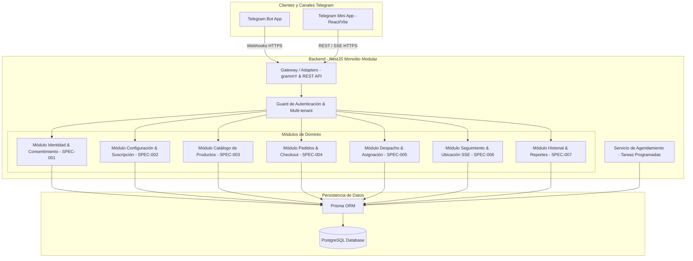

<!--
Agente: Architecture Agent
Proveedor: gemini
Modelo: gemini-3.5-flash
Fecha: 2026-11-21 15:58
Petición: Propón la arquitectura de Domiciliarios Eje a partir de las 7 SPEC aprobadas (SPEC-001 a SPEC-007). El stack todavía no está aprobado: la estudiante prefiere el que aparece en el contexto del proyecto (sección Stack de este prompt); evalúalo frente a alternativas reales con matriz y ADR. Incluye el modelo de datos conceptual con sus entidades principales y la separación de datos por negocio.
-->

# ARQ-001. Arquitectura Técnica de Domiciliarios Eje - Versión 0.1

Estado: Borrador
Modo: Propuesta
SPECs de origen: SPEC-001, SPEC-002, SPEC-003, SPEC-004, SPEC-005, SPEC-006, SPEC-007

## Resumen de la decisión
Se propone una arquitectura de Monolito Modular (Modular Monolith) con enfoque Hexagonal (Ports and Adapters) construida en TypeScript con NestJS, Prisma ORM y PostgreSQL. La interacción conversacional se implementa mediante el framework grammY recibiendo Webhooks de Telegram Bot API. Para interacciones visuales complejas (catálogo, armado de pedidos y mapa interactivo) se sirve una Telegram Mini App desarrollada en React con Vite y Leaflet/OpenStreetMap. La actualización del mapa en tiempo real utiliza Server-Sent Events (SSE) desde el backend. Todas las operaciones de negocio y la separación multi-inquilino se validan estrictamente en la capa de aplicación usando el discriminador `negocio_id` en PostgreSQL.

## Architecture Drivers
- Driver 1: Aislamiento estricto multi-inquilino (Multi-tenancy). Ningún usuario debe acceder o modificar datos de un negocio al que no pertenece. Origen: SPEC-001/RNF-002, SPEC-002/RNF-002, SPEC-003/RNF-001, SPEC-004/RNF-002, SPEC-005/RNF-002, SPEC-006/RNF-010, SPEC-007/RNF-001, contexto 3.3.
- Driver 2: Atomicidad y consistencia en transacciones críticas. La asignación de domiciliarios, control de cupo de carga y cambios de estado no deben permitir condiciones de carrera ni sobreasignación. Origen: SPEC-001/RNF-003, SPEC-002/RNF-003, SPEC-004/RNF-003, SPEC-005/RNF-003, SPEC-006/RNF-011, contexto 3.8.
- Driver 3: Protección de datos personales y trazabilidad de autorizaciones (Habeas Data - Ley 1581). Captura de consentimiento previo, desvinculación de datos sensibles fuera de la entrega activa y purga del recorrido histórico a los 30 días. Origen: SPEC-001/RNF-004, SPEC-001/RNF-005, SPEC-006/RNF-010, SPEC-007/RNF-002, contexto sección 6.
- Driver 4: Simplicidad de despliegue, mantenibilidad y viabilidad para proyecto individual. Desarrollo individual dentro del plazo de 8 semanas. Origen: contexto sección 4.
- Driver 5: Interoperabilidad con Telegram Bot API y soporte de interfaz conversacional y Mini App. Origen: SPEC-001/RF-001, SPEC-003/RF-009, SPEC-004/RF-004, SPEC-006/RF-057, contexto 3.1.

## Restricciones arquitectónicas
- Proyecto individual desarrollado bajo la metodología guiada por especificaciones SDD. Origen: contexto sección 4.
- Canales autorizados: Telegram Bot API (mensajería conversacional) y Telegram Mini App (interfaz gráfica de catálogo y mapas). Origen: contexto 3.1.
- Controles de seguridad centralizados en el backend: no confiar la autorización al cliente web ni a los menús del bot. Origen: contexto 3.2.
- Solución totalmente autónoma e independiente de servicios externos de pago. Origen: contexto sección 4 y 5.
- Cumplimiento normativo del régimen de protección de datos de Colombia (Ley 1581 de 2012 y Decreto 1377 de 2013). Origen: contexto sección 6.

## Atributos de calidad
- Atributo: Seguridad (Autenticación y Autorización). Condición: Cada petición valida la identidad en Telegram (`initData` o webhook token), comprueba la vinculación al negocio y verifica permisos de rol. Origen: SPEC-001/RNF-001.
- Atributo: Concurrencia y Consistencia. Condición: N intentos de asignación en paralelo sobre K cupos de domiciliario garantizan exactamente <= K éxitos sin bloqueos o estados corruptos. Origen: SPEC-005/RNF-003.
- Atributo: Mantenibilidad y Modificabilidad. Condición: Estructura modular independiente por dominio functional que permite evolucionar reglas de negocio sin acoplamiento. Origen: contexto sección 4.
- Atributo: Privacidad y Minimización de Datos. Condición: Ocultamiento automático de datos personales del cliente tras finalizar el pedido y eliminación irreversible de coordenadas a los 30 días. Origen: SPEC-006/RF-060, SPEC-005/BR-007.

## Preguntas de aclaración
- ARCH-Q-001. Las SPECs requieren tareas programadas y temporizadores en tres escalas de tiempo distintas: 3 minutos para la expiración de asignaciones a domiciliarios (SPEC-005/RF-005), 7 días para la expiración de solicitudes pendientes (SPEC-001/RF-018) y 30 días para la purga de recorridos históricos (SPEC-006/RF-060). Para mantener la simplicidad de despliegue en un servidor único según las restricciones de tiempo del proyecto (contexto sección 4), ¿se debe implementar la programación de tareas asíncronas mediante el módulo de agendamiento interno de NestJS (`@nestjs/schedule`), o se autoriza la inclusión de un gestor de colas externo como Redis con BullMQ?
  Por qué importa: Define la arquitectura de infraestructura del backend, la necesidad de contenedores auxiliares en producción y la complejidad operacional del proyecto individual.
  Crítica: sí
  Estado: Pendiente
  Responsable: equipo

- ARCH-Q-002. Para el seguimiento de la ubicación del domiciliario en tiempo real hacia la Telegram Mini App (SPEC-006/RF-057, RF-058), la propuesta preferida plantea Server-Sent Events (SSE). ¿Se confirma el uso de SSE (streaming unidireccional HTTP/HTTPS desde el backend a la Mini App) alimentado por los webhooks de Telegram, evitando establecer una arquitectura de WebSockets bidireccionales?
  Por qué importa: Determina el patrón de comunicación en tiempo real del backend, el consumo de conexiones concurrentes y la tecnología de integración en el cliente React/Vite de la Mini App.
  Crítica: sí
  Estado: Pendiente
  Responsable: equipo

- ARCH-Q-003. Para el almacenamiento de imágenes de productos (SPEC-003/RF-001) y la entrega de códigos QR (SPEC-002/RF-003), el contexto exige un funcionamiento independiente y sin costos adicionales (contexto secciones 4 y 5). ¿Se confirma utilizar los `file_id` nativos de la Telegram Bot API e imágenes servidas de forma estática por el backend en volumen local, descartando servicios cloud de pago tipo AWS S3?
  Por qué importa: Define la arquitectura de almacenamiento de archivos multimedia, la persistencia en el servidor y el acoplamiento con la API de Telegram.
  Crítica: no
  Estado: Pendiente
  Responsable: equipo

- ARCH-Q-004. Las reglas críticas del proyecto y las SPECs (SPEC-001/RF-010, SPEC-005/RF-004, SPEC-005/RNF-003) exigen que la asignación de domiciliarios y la exclusividad del repartidor sean atómicas y eviten sobreasignación concurrente. ¿Se confirma aplicar el patrón de `transaccion-critica` directamente mediante transacciones ACID y bloqueos a nivel de base de datos PostgreSQL/Prisma, sin requerir cachés de sincronización en memoria?
  Por qué importa: Garantiza la consistencia en el backend frente a llamadas simultáneas, define la estrategia transaccional del ORM y cumple las reglas de auditoría y atomicidad sin pérdidas de datos.
  Crítica: sí
  Estado: Pendiente
  Responsable: equipo

## Alternativas consideradas
- Alternativa 1: Monolito Modular en NestJS + TypeScript + Prisma + PostgreSQL + grammY + React/Vite Mini App (Propuesta preferida).
  Descripción: Aplicación única desplegada en contenedor Node.js/NestJS dividida en módulos de dominio con fronteras claras. La API gestiona Webhooks de Telegram mediante grammY y expone endpoints REST/SSE para la Mini App en React. Persistencia unificada en PostgreSQL con Prisma ORM.
  Ventajas: Alta coherencia de tipado en TypeScript de extremo a extremo, desarrollo rápido, bajo consumo de recursos en servidor único, alineado con las restricciones del proyecto individual.
  Desventajas: Requiere disciplina para no violar los límites entre módulos mediante imports directos.

- Alternativa 2: Arquitectura de Microservicios basada en Go / FastAPI con RabbitMQ y Bases de Datos Independientes por Servicio.
  Descripción: División en microservicios independientes (Auth Service, Catalog Service, Order Service, Tracking Service, Notification Service) comunicados vía eventos con RabbitMQ.
  Ventajas: Escalabilidad independiente de componentes y aislamiento físico de datos.
  Desventajas: Complejidad desproporcionada para un desarrollo individual de 8 semanas, sobrecosto operativo, dificultad para garantizar transacciones ACID atómicas entre servicios en la asignación de repartidores.

- Alternativa 3: Monolito Tradicional Django + Python + Celery + PostgreSQL.
  Descripción: Backend en Python utilizando Django REST Framework, interfaz de bot con python-telegram-bot y tareas asíncronas con Celery.
  Ventajas: Framework maduro con ORM potente y panel administrativo integrado.
  Desventajas: Integración menos fluida con el frontend de la Mini App en React/Vite frente al ecosistema TypeScript unificado; mayor latencia en eventos de tiempo real sin configuración compleja de ASGI/Channels.

## Matriz de decisión

| Criterio (Peso) | Alt 1: Monolito Modular NestJS | Alt 2: Microservicios Go/FastAPI | Alt 3: Monolito Django |
|---|---|---|---|
| Mantenibilidad y Simplicidad (0.30) | 4.8 | 2.0 | 4.0 |
| Seguridad y Aislamiento Multi-tenant (0.25) | 4.5 | 4.5 | 4.2 |
| Atomicidad y Consistencia (0.25) | 4.8 | 3.0 | 4.5 |
| Tiempo de desarrollo / Viabilidad (0.20) | 4.7 | 1.8 | 3.8 |
| **Total** | **4.71** | **2.80** | **4.15** |

Justificación de pesos:
- Mantenibilidad y Simplicidad (0.30): El proyecto es desarrollado por una sola persona en un plazo de 8 semanas (contexto sección 4).
- Seguridad y Aislamiento Multi-tenant (0.25): Restricción crítica del sistema (contexto 3.3).
- Atomicidad y Consistencia (0.25): Obligación del dominio para evitar sobreasignación y estados inconsistentes (contexto 3.8, SPEC-005).
- Tiempo de desarrollo / Viabilidad (0.20): Límite temporal de entrega del proyecto académico.

## Arquitectura seleccionada
- Decisión: Monolito Modular (Modular Monolith) en TypeScript con NestJS, Prisma ORM, PostgreSQL, grammY para el bot de Telegram y React + Vite para la Telegram Mini App.
- Por qué: Ofrece el balance óptimo entre velocidad de desarrollo individual, fuerte consistencia transaccional ACID en PostgreSQL para el control de concurrencia en asignaciones, y fronteras claras entre módulos funcionales sin sobrecosto de infraestructura.
- ADR: ADR-001, ADR-002, ADR-003, ADR-004.

## Diagrama conceptual



## Componentes y responsabilidades

- COMP-001. Bot Gateway & Adapter (`grammY`): Recibe webhooks de la Telegram Bot API, gestiona flujos conversacionales (menús, formularios de datos) y enruta comandos hacia los servicios de aplicación. Traza a: SPEC-001/RF-001, SPEC-004/RF-004, ADR-003.
- COMP-002. Mini App Frontend (`React + Vite + Leaflet`): Renderiza la interfaz web integrada en Telegram para navegación por categorías del catálogo, armado de carrito, selección de barrio y mapa interactivo con Leaflet/OSM alimentado por SSE. Traza a: SPEC-003/RF-009, SPEC-004/RF-004, SPEC-006/RF-057, ADR-003.
- COMP-003. Identity & Consent Module: Administra el registro de negocios, vinculación de empleados/domiciliarios, clientes, verificación de teléfono nativo de Telegram y almacenamiento inmutable de autorizaciones legales (Ley 1581). Traza a: SPEC-001/RF-001 a RF-020, ADR-001.
- COMP-004. Business Configuration & Subscription Module: Gestiona parámetros de establecimientos, horarios por día/festivos, formas de pago aceptadas, monto mínimo de compra, generación de enlaces/QR diferenciados y estado de suscripción controlado por la plataforma. Traza a: SPEC-002/RF-001 a RF-021, ADR-001.
- COMP-005. Catalog Module: Controla la creación y organización de productos por categorías, precios, disponibilidad (activo, agotado, desactivado) y unicidad de nombres. Traza a: SPEC-003/RF-001 a RF-010, ADR-001.
- COMP-006. Order Management Module: Procesa el registro de pedidos, cálculo de totales con tarifa de domicilio, detección de duplicados en 5 minutos, revalidación de catálogo, validación de monto mínimo y ciclo de estado inicial (recibido, en preparación, rechazado, cancelado). Traza a: SPEC-004/RF-001 a RF-017, ADR-001.
- COMP-007. Dispatch & Assignment Module: Administra la consola de despacho, asignación atómica de domiciliarios controlando el tope de carga simultánea (1-7), temporizador de respuesta de 3 minutos y gestión de disponibilidad del repartidor. Traza a: SPEC-005/RF-001 a RF-011, ADR-004.
- COMP-008. Real-time Tracking & Geolocation Module: Recibe coordenadas GPS del domiciliario vía Telegram en el estado "en camino", transmite stream SSE a la Mini App, gestiona pérdida de señal, registra confirmación de cobro presencial y purga recorridos a los 30 días. Traza a: SPEC-006/RF-050 a RF-060, ADR-001.
- COMP-009. Audit & Analytics Module: Genera la trazabilidad inmutable de cambios de estado, historial filtrable y reportes consolidados (pedidos por estado, recaudo por zona y ventas del catálogo), garantizando el aislamiento por negocio y restricciones de rol. Traza a: SPEC-007/RF-001 a RF-009, ADR-002.
- COMP-010. Database Layer (`Prisma ORM + PostgreSQL`): Capa de datos relacional con esquema multi-inquilino. Aplica restricciones de unicidad, claves foráneas, índices de desempeño y aislamiento transaccional. Traza a: SPEC-001/RNF-003, SPEC-005/RNF-003, ADR-002, ADR-004.

## Integraciones y flujos técnicos

- Integración Bot de Telegram (Webhook HTTPS): Telegram entrega mensajes y eventos nativos (ej. compartir contacto) al webhook `/api/telegram/webhook`. El backend valida el token secreto en cabecera HTTP y procesa la actualización con grammY. Origen: SPEC-001/RF-002, SPEC-004/RF-003.
- Autenticación Telegram Mini App (`initData` validation): La Mini App envía la cadena `Telegram.WebApp.initData` en la cabecera `Authorization`. El backend valida la firma HMAC-SHA256 con el token del bot de Telegram, extrae la identidad del usuario y emite un token de sesión interno con claims de `usuario_id`, `rol` y `negocio_id`. Origen: SPEC-001/RNF-001, SPEC-003/RF-005.
- Transmisión de Ubicación en Tiempo Real (Telegram -> Backend -> SSE Mini App):
  1. El domiciliario comparte ubicación en directo en el chat de Telegram (estado "en camino").
  2. Telegram envía eventos `EditedMessage` con latitud/longitud al Webhook.
  3. El `TrackingModule` guarda la coordenada en PostgreSQL y emite un evento interno NestJS `EventEmitter`.
  4. El endpoint `/api/tracking/stream/:pedidoId` transmite la coordenada formateada vía Server-Sent Events (SSE) a la Telegram Mini App del cliente o administrador. Origen: SPEC-006/RF-050, RF-057, RF-058.

## ADR

- ADR-001. Selección de Arquitectura Monolito Modular en NestJS con TypeScript
  Estado: Propuesta
  Contexto: El proyecto requiere desarrollar un backend completo de gestión de domicilios en Telegram con 7 módulos funcionales en un plazo de 8 semanas por un solo desarrollador.
  Problema: Definir una estructura técnica que minimice el tiempo de configuración y despliegue sin sacrificar la mantenibilidad y la clara separación de responsabilidades.
  Alternativas: (a) Microservicios; (b) Monolito Tradicional; (c) Monolito Modular en NestJS.
  Decisión: Adoptar un Monolito Modular en NestJS usando arquitectura Hexagonal por módulo.
  Justificación: NestJS provee inyección de dependencias, estructura orientada a módulos de dominio y compatibilidad nativa con TypeScript. Permite aislar la lógica de negocio y mantiene la facilidad de despliegue en un único contenedor.
  Consecuencias positivas: Desarrollo rápido, tipado estático compartido, bajo consumo de RAM, pruebas sencillas.
  Consecuencias negativas: Requiere disciplina para no importar repositorios directamente entre módulos.
  Supuestos: Un único servidor o contenedor Docker es suficiente para la carga esperada.
  Evidencia: Contexto sección 4 (plazo de 8 semanas, desarrollo individual).

- ADR-002. Aislamiento Multi-inquilino mediante Discriminador de Negocio en PostgreSQL
  Estado: Propuesta
  Contexto: Toda la información pertence a un negocio específico y ningún usuario puede acceder a datos de otro establecimiento.
  Problema: Determinar la estrategia de persistencia multi-inquilino (Multi-tenancy).
  Alternativas: (a) Base de datos por negocio; (b) Esquema PostgreSQL por negocio; (c) Columna discriminadora (`negocio_id`) en tabla compartida con filtros obligatorios.
  Decisión: Utilizar columna discriminadora `negocio_id` en PostgreSQL con validación forzada en el backend (Prisma Middleware / Guards).
  Justificación: Evita la complejidad de migraciones dinámicas de esquemas o múltiples bases de datos, manteniendo un desempeño óptimo y fácil mantenimiento para el volumen del proyecto.
  Consecuencias positivas: Consultas simples, migraciones de base de datos centralizadas, menor costo de infraestructura.
  Consecuencias negativas: Toda consulta SQL/Prisma debe incluir la cláusula `WHERE negocio_id = X`.
  Supuestos: El backend valida siempre el `negocio_id` desde el token/sesión autenticado antes de consultar la BD.
  Evidencia: Contexto 3.3, SPEC-001/RNF-002, SPEC-002/RNF-002, SPEC-005/RNF-002.

- ADR-003. Interfaz Dual: Telegram Bot (grammY) + Telegram Mini App (React + Vite)
  Estado: Propuesta
  Contexto: Telegram es el canal principal de interacción, pero ciertas funciones requieren formularios extensos (catálogo) y mapas interactivos (ubicación).
  Problema: Definir cómo estructurar la interfaz de usuario para optimizar la experiencia en móvil.
  Alternativas: (a) Solo Bot conversacional con botones inline; (b) Bot conversacional + Telegram Mini App web; (c) Aplicación Web/Móvil independiente.
  Decisión: Implementar interfaz dual con Bot conversacional (grammY) para comandos, avisos y notificaciones, y Telegram Mini App (React + Vite) para catálogo, carrito de compra y mapas de seguimiento.
  Justificación: Respeta la decisión DEC-E47 y las SPECs. La Mini App corre dentro de Telegram sin exigir instalar aplicaciones adicionales ni pedir logins externos.
  Consecuencias positivas: Excelente experiencia visual de catálogo y mapa; flujo fluido en Telegram.
  Consecuencias negativas: Implica construir dos clientes (flujo bot y app web en React).
  Supuestos: La Telegram Bot API soporta el lanzamiento de Mini Apps vía botones `WebAppInfo`.
  Evidencia: Contexto 3.1, SPEC-003/RF-009, SPEC-004/RF-004, SPEC-006/RF-057.

- ADR-004. Estrategia de Concurrencia y Atomicidad en la Asignación de Domiciliarios
  Estado: Propuesta
  Contexto: Dos empleados pueden intentar asignar el mismo pedido al mismo tiempo, o asignar a un repartidor que está al límite de su tope de carga simultánea (1-7).
  Problema: Prevenir sobreasignación y condiciones de carrera sin corromper el estado.
  Alternativas: (a) Control de concurrencia optimista en memoria; (b) Transacciones relacionales ACID con bloqueo pesimista en PostgreSQL (`SELECT ... FOR UPDATE`); (c) Semáforos Redis.
  Decisión: Implementar transacciones pesimistas ACID en PostgreSQL a través de la capa de persistencia/Prisma, aplicando el patrón `transaccion-critica`.
  Justificación: Garantiza que la lectura de la carga actual del domiciliario y la actualización del estado del pedido ocurran de manera atómica dentro de la misma transacción en la base de datos principal, sin requerir infraestructura adicional.
  Consecuencias positivas: Cero sobreasignaciones, consistencia garantizada por el motor SQL.
  Consecuencias negativas: Pequeño bloqueo temporal a nivel de fila durante la transacción.
  Supuestos: La carga de operaciones simultáneas sobre el mismo pedido es baja a media.
  Evidencia: SPEC-001/RNF-003, SPEC-005/RF-004, SPEC-005/RNF-003, Skill `transaccion-critica`.

## Decisiones de diseño y patrones
- Patrón Hexagonal / Ports & Adapters: Separa los adaptadores de entrada (Bot grammY, Controladores REST Mini App) de los servicios de aplicación y del modelo de dominio. Traza a: SPEC-001/RNF-001.
- Patrón Transacción Crítica: Aplicado en la asignación de domiciliarios (SPEC-005/RF-004) y conmutación de suscripción con cancelación masiva (SPEC-002/RF-016). Ejecuta las validaciones (`WHERE estado = 'EN_PREPARACION' AND domiciliario_id IS NULL`) directamente dentro de la instrucción de actualización transaccional SQL. Traza a: SPEC-005/RNF-003, skill `transaccion-critica`.
- Patrón Repository: Aísla la capa de persistencia Prisma ORM de los servicios de aplicación. Traza a: SPEC-001/RNF-002.
- Patrón Guard / Interceptor Multi-tenant: Middleware global NestJS que extrae y valida el `negocio_id` del token JWT/initData e inyecta el contexto de negocio en la petición. Traza a: SPEC-001/RNF-001, SPEC-002/RNF-002.

## Riesgos técnicos
- Riesgo: Caducidad o pérdida de señal GPS del domiciliario durante el estado "en camino". Impacto: Medio. Probabilidad: Alta. Mitigación: SPEC-006/RF-056 establece que ante la interrupción de señal el pedido permanece "en camino" con la última ubicación y su hora exacta, notificando al negocio para coordinar fuera del bot.
- Riesgo: Latencia o bloqueo por límites de frecuencia (Rate Limits) de la Telegram Bot API al enviar notificaciones masivas o cancelaciones. Impacto: Medio. Probabilidad: Media. Mitigación: Implementar cola de envíos con reintentos exponenciales en el adaptador del bot.
- Riesgo: Intento de bypass de autorización invocando endpoints de la Mini App sin pasar por Telegram. Impacto: Alto. Probabilidad: Media. Mitigación: Validación matemática obligatoria de la firma HMAC-SHA256 del `initData` de Telegram en cada petición REST/SSE del backend.

## Supuestos
- Supuesto 1: El servidor de despliegue cuenta con soporte para conexiones HTTPS obligatorias (requerido por Webhooks de Telegram y Telegram Mini App). Requiere validación: Estudiante durante la fase de despliegue (uso de Caddy/Nginx con Let's Encrypt o Nrok en desarrollo).
- Supuesto 2: Los usuarios finales utilizan la aplicación oficial de Telegram en dispositivos móviles con soporte nativo para compartir ubicación en tiempo real. Requiere validación: Pruebas funcionales.

## Preguntas técnicas abiertas
- Mecanismo de ejecución de tareas programadas en segundo plano (expiración de 3 min, 7 días y purga de 30 días): pendiente de confirmación en ARCH-Q-001.
- Protocolo exacto para mapas en tiempo real (confirmación de SSE): pendiente de confirmación en ARCH-Q-002.
- Almacenamiento estático de imágenes y códigos QR: pendiente de confirmación en ARCH-Q-003.

## Trazabilidad
- SPEC-001/RF-001 → Driver 4, Driver 5 → ADR-001, ADR-003 → COMP-001, COMP-003 → Implementación/TEST (pendiente de Planning/QA).
- SPEC-001/RNF-002 → Driver 1 → ADR-002 → COMP-010, Guard Multi-tenant → Implementación/TEST (pendiente de Planning/QA).
- SPEC-002/RF-016 → Driver 2 → ADR-004 → COMP-004, Patrón Transacción Crítica → Implementación/TEST (pendiente de Planning/QA).
- SPEC-003/RF-009 → Driver 5 → ADR-003 → COMP-002, COMP-005 → Implementación/TEST (pendiente de Planning/QA).
- SPEC-004/RF-009 → Driver 2 → ADR-001 → COMP-006 (Detección de duplicados 5 min) → Implementación/TEST (pendiente de Planning/QA).
- SPEC-005/RF-004 → Driver 2 → ADR-004 → COMP-007, Patrón Transacción Crítica → Implementación/TEST (pendiente de Planning/QA).
- SPEC-006/RF-057 → Driver 5 → ADR-003 → COMP-002, COMP-008 (SSE Map Tracking) → Implementación/TEST (pendiente de Planning/QA).
- SPEC-007/RF-004 → Driver 1, Driver 3 → ADR-002 → COMP-009 → Implementación/TEST (pendiente de Planning/QA).

## Modelo de datos conceptual y separación por negocio

El modelo de datos relacional se estructura asegurando que toda entidad operativa pertenezca a un `Negocio` mediante la columna `negocio_id` (salvo las tablas del dueño de la plataforma e identidades globales de Telegram).

```text
[Plataforma]
  ├── FestivoPlataforma (id, fecha, descripcion)
  └── SuscripcionHistorial (id, negocio_id, estado, fecha, responsable_id)

[Usuario Global]
  └── Usuario (id, telegram_id, nombre_cuenta, telefono_verificado, creado_en)
        ├── AutorizacionDatos (id, usuario_id, tipo, version, fecha_aceptacion, revocada)
        └── Sesion (id, usuario_id, token, expira_en)

[Negocio - Inquilino / Tenant]
  └── Negocio (id, nombre_comercial, ciudad, direccion, correo_habeas_data, estado_suscripcion, fecha_registro)
        │
        ├── AccesoNegocio (id, negocio_id, tipo [CLIENTE|PERSONAL], codigo, enlace_profundo, qr_code_url)
        ├── ConfiguraciónNegocio (id, negocio_id, tope_pedidos_domiciliario, valor_minimo_compra)
        ├── HorarioAtencion (id, negocio_id, dia_semana, hora_apertura, hora_cierre, esta_cerrado, atiende_festivos)
        ├── FormaPagoNegocio (id, negocio_id, tipo_fijo [EFECTIVO|TRANSFERENCIA|DATAFONO], nombre_personalizado, requiere_cobro_entrega, activa)
        ├── ZonaCobertura (id, negocio_id, nombre_barrio, tarifa_domicilio, activa)
        │
        ├── VinculacionPersonal (id, negocio_id, usuario_id, rol [ADMIN|EMPLEADO|DOMICILIARIO], estado_disponibilidad, activa)
        ├── SolicitudRegistroNegocio (id, usuario_solicitante_id, estado, motivo_rechazo, expira_en)
        ├── SolicitudVinculacion (id, negocio_id, usuario_id, rol_solicitado, estado, motivo_rechazo, expira_en)
        │
        ├── CategoriaProducto (id, negocio_id, nombre)
        │     └── Producto (id, negocio_id, categoria_id, nombre, precio, descripcion, imagen_url, estado [ACTIVO|AGOTADO|DESACTIVADO])
        │
        └── Pedido (id, negocio_id, cliente_usuario_id, domiciliario_vinculacion_id, zona_cobertura_id, forma_pago_id,
                   estado [RECIBIDO|EN_PREPARACION|LISTO_PARA_RECOGER|EN_CAMINO|ENTREGADO|CON_NOVEDAD|CANCELADO|RECHAZADO],
                   subtotal_productos, tarifa_domicilio, total, direccion_entrega, referencias, cobrado_confirmado, creado_en)
              │
              ├── DetallePedido (id, pedido_id, producto_id, nombre_snapshot, precio_snapshot, cantidad)
              ├── TrazabilidadEstadoPedido (id, pedido_id, estado_anterior, estado_nuevo, actor_usuario_id, fecha_hora, motivo_texto)
              └── RecorridoUbicacion (id, pedido_id, latitud, longitud, fecha_hora) [Se purga a los 30 dias]
```

Mecanismo de Separación de Datos por Negocio:
1. Claves Foráneas Obligatorias: Todas las tablas operativas (`Pedido`, `Producto`, `ZonaCobertura`, `VinculacionPersonal`, etc.) contienen la columna `negocio_id` con restricción `FOREIGN KEY` hacia `Negocio(id)`.
2. Aislamiento en Consultas SQL / ORM: Toda consulta ejecutada por el sistema añade explícitamente el filtro `WHERE negocio_id = :tenant_id`.
3. Unicidad por Negocio: Reglas como la unicidad del nombre de producto (SPEC-003/BR-009) o nombre de barrio (SPEC-002/BR-008) se implementan mediante índices únicos compuestos: `CREATE UNIQUE INDEX idx_producto_nombre_negocio ON Producto(negocio_id, lower(nombre));`.

## Verificación
- Completitud: cumple. Se incluyeron todas las secciones requeridas, definiendo arquitectura, ADRs, matriz de decisión, diagramas y modelo conceptual de datos.
- Consistencia con las SPECs: cumple. Cada componente, driver y decisión traza a requisitos específicos de SPEC-001 a SPEC-007 y a las secciones 3, 4 y 6 del contexto.
- No invención: cumple. Se utilizaron las restricciones del contexto y las SPECs congeladas. Las incertidumbres operativas se formularon como preguntas ARCH-Q.
- Justificación: cumple. Las alternativas de arquitectura fueron comparadas con criterios y pesos explícitos justificados por las restricciones del proyecto.
- Defensa: cumple. La propuesta de Monolito Modular responde a la capacidad real de desarrollo individual en 8 semanas sin sobreingeniería.

## Historial de cambios
- Versión 0.1: Estudio inicial de análisis y propuesta borrador de arquitectura técnica integrando SPEC-001 a SPEC-007; preguntas ARCH-Q-001 a ARCH-Q-004 registradas como pendientes.

## Siguiente paso
Respondan las preguntas ARCH-Q-001 a ARCH-Q-004 y ejecuten de nuevo el agente con `--continuar ARQ-001` para congelar la versión 1.0 Candidata.
