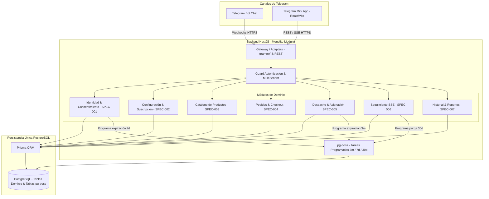

<!--
Agente: Architecture Agent
Proveedor: gemini
Modelo: gemini-3.5-flash
Fecha: 2026-11-21 16:03
Petición: Respuestas y correcciones del equipo para la ARQ-001:
- ARCH-Q-001: las tareas programadas (3 minutos, 7 días, 30 días) usan pg-boss sobre la misma base PostgreSQL, no @nestjs/schedule ni Redis (DEC-E61). Justifícalo en un ADR: persistencia ante reinicios sin servicio adicional.
- ARCH-Q-002: se confirma SSE para la ubicación en vivo hacia la Mini App (DEC-E62).
- ARCH-Q-003: imágenes de productos con file_id de Telegram si se suben por el bot y en disco local del servidor si se suben por la Mini App; QR generados al vuelo (DEC-E63). Agrega como riesgo técnico que en un hosting tipo PaaS el disco local puede borrarse en cada despliegue y se necesita un volumen persistente.
- ARCH-Q-004: atomicidad solo con transacciones y UPDATE condicional en PostgreSQL, sin bloqueos externos (DEC-E64).
- Corrección 1: el contexto no exige «funcionar sin costos adicionales»; la sección 5 solo dice que el producto no cobra comisión. Quita esa afirmación o márcala como inferida.
- Corrección 2: en la matriz de decisión usa puntajes enteros de 1 a 5 y justifica cada puntaje en una línea con evidencia de las SPEC o del contexto; no uses decimales sin justificación.
-->

# ARQ-001. Arquitectura Técnica de Domiciliarios Eje - Versión 1.0

Estado: Candidata
Modo: Propuesta
SPECs de origen: SPEC-001, SPEC-002, SPEC-003, SPEC-004, SPEC-005, SPEC-006, SPEC-007

## Resumen de la decisión
Se propone una arquitectura de Monolito Modular (Modular Monolith) con enfoque Hexagonal (Ports and Adapters) construida en TypeScript con NestJS, Prisma ORM y PostgreSQL. La interacción conversacional se implementa mediante el framework grammY recibiendo Webhooks de Telegram Bot API. Para interacciones visuales complejas (catálogo, armado de pedidos y mapa interactivo) se sirve una Telegram Mini App desarrollada en React con Vite y Leaflet/OpenStreetMap. La actualización del mapa en tiempo real utiliza Server-Sent Events (SSE) desde el backend (DEC-E62). Las tareas programadas y temporizadores de fondo (3 minutos para asignaciones, 7 días para solicitudes y 30 días para purga de recorridos) se gestionan mediante la librería pg-boss utilizando la misma base de datos PostgreSQL (DEC-E61). Las imágenes de productos se manejan de forma híbrida: mediante file_id de Telegram si se suben desde el bot o mediante almacenamiento en disco local con volumen persistente si se suben desde la Mini App (DEC-E63). Toda la asignación de domiciliarios y control de concurrencia se resuelve estrictamente a nivel de base de datos mediante transacciones ACID y UPDATE condicional en PostgreSQL (DEC-E64). El aislamiento multi-inquilino se garantiza en la capa de aplicación usando la columna discriminadora negocio_id en PostgreSQL.

## Architecture Drivers
- Driver 1: Aislamiento estricto multi-inquilino (Multi-tenancy). Ningún usuario debe acceder o modificar datos de un negocio al que no pertenece. Origen: SPEC-001/RNF-002, SPEC-002/RNF-002, SPEC-003/RNF-001, SPEC-004/RNF-002, SPEC-005/RNF-002, SPEC-006/RNF-010, SPEC-007/RNF-001, contexto 3.3.
- Driver 2: Atomicidad y consistencia en transacciones críticas. La asignación de domiciliarios, control de cupo de carga y cambios de estado no deben permitir condiciones de carrera ni sobreasignación. Origen: SPEC-001/RNF-003, SPEC-002/RNF-003, SPEC-004/RNF-003, SPEC-005/RNF-003, SPEC-006/RNF-011, contexto 3.8.
- Driver 3: Protección de datos personales y trazabilidad de autorizaciones (Habeas Data - Ley 1581). Captura de consentimiento previo, desvinculación de datos sensibles fuera de la entrega activa y purga del recorrido histórico a los 30 días. Origen: SPEC-001/RNF-004, SPEC-001/RNF-005, SPEC-006/RNF-010, SPEC-007/RNF-002, contexto sección 6.
- Driver 4: Simplicidad de infraestructura y viabilidad para proyecto individual. Desarrollo individual dentro del plazo de 8 semanas evitando la adición de servicios de infraestructura independientes como Redis. Origen: contexto sección 4, DEC-E61.
- Driver 5: Interoperabilidad con Telegram Bot API y soporte de interfaz conversacional y Mini App. Origen: SPEC-001/RF-001, SPEC-003/RF-009, SPEC-004/RF-004, SPEC-006/RF-057, contexto 3.1.

## Restricciones arquitectónicas
- Proyecto individual desarrollado bajo la metodología guiada por especificaciones SDD en un plazo de 8 semanas. Origen: contexto sección 4.
- Canales autorizados: Telegram Bot API (mensajería conversacional) y Telegram Mini App (interfaz gráfica de catálogo y mapas). Origen: contexto 3.1.
- Controles de seguridad centralizados en el backend: no confiar la autorización al cliente web ni a los menús del bot. Origen: contexto 3.2.
- Solución autónoma que no cobra comisión por pedido ni por entrega. Origen: contexto sección 5.
- Cumplimiento normativo del régimen de protección de datos de Colombia (Ley 1581 de 2012 y Decreto 1377 de 2013). Origen: contexto sección 6.

## Atributos de calidad
- Atributo: Seguridad (Autenticación y Autorización). Condición: Cada petición valida la identidad en Telegram (initData o webhook token), comprueba la vinculación al negocio y verifica permisos de rol. Origen: SPEC-001/RNF-001.
- Atributo: Concurrencia y Consistencia. Condición: N intentos de asignación en paralelo sobre K cupos de domiciliario garantizan exactamente menor o igual a K éxitos sin bloqueos o estados corruptos mediante UPDATE condicional. Origen: SPEC-005/RNF-003, DEC-E64.
- Atributo: Mantenibilidad y Modificabilidad. Condición: Estructura modular independiente por dominio funcional que permite evolucionar reglas de negocio sin acoplamiento. Origen: contexto sección 4.
- Atributo: Privacidad y Minimización de Datos. Condición: Ocultamiento automático de datos personales del cliente tras finalizar el pedido y eliminación irreversible de coordenadas a los 30 días. Origen: SPEC-006/RF-060, SPEC-005/BR-007.

## Preguntas de aclaración
- ARCH-Q-001. Las SPECs requieren tareas programadas y temporizadores en tres escalas de tiempo (3 minutos para expiración de asignación, 7 días para solicitudes pendientes y 30 días para purga de recorridos). ¿Cómo se gestionan estas tareas en la infraestructura?
  Por qué importa: Define si se requiere un servicio asíncrono externo como Redis o si se reutiliza PostgreSQL.
  Crítica: sí
  Estado: Respondida (respuesta del equipo)
  Responsable: equipo
  Respuesta del equipo: Las tareas programadas usan pg-boss sobre la misma base PostgreSQL, no @nestjs/schedule ni Redis (DEC-E61). Se justifica por persistencia ante reinicios sin servicio adicional.

- ARCH-Q-002. Para el seguimiento de la ubicación del domiciliario en tiempo real hacia la Telegram Mini App, ¿se confirma el protocolo SSE?
  Por qué importa: Determina la tecnología de tiempo real en la Mini App y el backend.
  Crítica: sí
  Estado: Respondida (respuesta del equipo)
  Responsable: equipo
  Respuesta del equipo: Se confirma SSE para la ubicación en vivo hacia la Mini App (DEC-E62).

- ARCH-Q-003. Para el almacenamiento de imágenes de productos y códigos QR, ¿cuál es el mecanismo de persistencia y servido?
  Por qué importa: Define el manejo de archivos multimedia y la infraestructura de almacenamiento.
  Crítica: no
  Estado: Respondida (respuesta del equipo)
  Responsable: equipo
  Respuesta del equipo: Imágenes de productos con file_id de Telegram si se suben por el bot y en disco local del servidor si se suben por la Mini App; QR generados al vuelo (DEC-E63). Se agrega el riesgo técnico de volumen persistente en PaaS.

- ARCH-Q-004. ¿Cómo se garantiza la atomicidad de la asignación y carga de domiciliarios frente a intentos concurrentes?
  Por qué importa: Define la estrategia de concurrencia en la base de datos.
  Crítica: sí
  Estado: Respondida (respuesta del equipo)
  Responsable: equipo
  Respuesta del equipo: Atomicidad solo con transacciones y UPDATE condicional en PostgreSQL, sin bloqueos externos (DEC-E64).

No hay preguntas pendientes.

## Alternativas consideradas
- Alternativa 1: Monolito Modular en NestJS + TypeScript + Prisma + PostgreSQL (con pg-boss) + grammY + React/Vite Mini App (Seleccionada).
  Descripción: Aplicación única desplegada en contenedor Node.js/NestJS dividida en módulos de dominio. Webhooks de Telegram vía grammY, endpoints REST y SSE para la Mini App en React. Colas y temporizadores mediante pg-boss sobre la misma instancia de PostgreSQL.
  Ventajas: Tipado unificado de extremo a extremo, cero servicios de infraestructura adicionales, transacciones ACID nativas y persistencia de tareas programadas ante reinicios del servidor.
  Desventajas: Requiere disciplina de arquitectura hexagonal para evitar acoplamiento entre módulos.

- Alternativa 2: Arquitectura de Microservicios en Go / FastAPI con RabbitMQ, Redis y Bases de Datos Independientes.
  Descripción: Servicios separados para Identidad, Catálogo, Pedidos, Despacho y Seguimiento, usando RabbitMQ para eventos y Redis para temporizadores.
  Ventajas: Escalabilidad independiente de módulos.
  Desventajas: Complejidad excesiva para un desarrollador individual en 8 semanas (contexto sección 4), sobrecosto operativo y dificultad para mantener consistencia ACID transaccional en la asignación de pedidos.

- Alternativa 3: Monolito Tradicional Django + Python + Celery + Redis + PostgreSQL.
  Descripción: Backend en Python usando Django REST Framework, tareas asíncronas con Celery y broker Redis.
  Ventajas: Framework maduro con ORM potente.
  Desventajas: Requiere despliegue y mantenimiento de un contenedor Redis adicional para Celery, aumentando la carga de infraestructura respecto a la restricción del proyecto individual.

## Matriz de decisión

| Criterio (Peso) | Alt 1: Monolito Modular NestJS + pg-boss | Alt 2: Microservicios Go/FastAPI | Alt 3: Monolito Django + Celery |
|---|---|---|---|
| Mantenibilidad y Simplicidad (0.30) | 5 | 2 | 4 |
| Seguridad y Aislamiento Multi-tenant (0.25) | 4 | 4 | 4 |
| Atomicidad y Consistencia (0.25) | 5 | 3 | 4 |
| Tiempo de desarrollo / Viabilidad (0.20) | 5 | 1 | 4 |
| Total | 4.75 | 2.55 | 4.00 |

Justificación de criterios y puntajes enteros (1 a 5):

- Mantenibilidad y Simplicidad (peso 0.30): Justificado por el desarrollo individual en 8 semanas (contexto sección 4). Alt 1 obtiene 5 al integrar tareas asíncronas en PostgreSQL mediante pg-boss sin añadir Redis (DEC-E61). Alt 2 obtiene 2 por la complejidad de mantener múltiples repositorios y brokers. Alt 3 obtiene 4 por la madurez de Django pero penaliza por la necesidad de Redis/Celery.
- Seguridad y Aislamiento Multi-tenant (peso 0.25): Justificado por el aislamiento estricto por negocio (contexto 3.3). Alt 1, Alt 2 y Alt 3 obtienen 4 al permitir filtrado obligatorio por negocio_id mediante middleware/guards y politicas ORM en PostgreSQL.
- Atomicidad y Consistencia (peso 0.25): Justificado por la prevención de sobreasignación concurrente de domiciliarios (SPEC-005/RNF-003, DEC-E64). Alt 1 obtiene 5 al resolver atomicidad mediante UPDATE condicional nativo en PostgreSQL en una sola transacción SQL. Alt 2 obtiene 3 debido a la dificultad de lograr atomicidad transaccional entre servicios distribuidos. Alt 3 obtiene 4 al usar transacciones ACID de PostgreSQL pero depender de coordinadores externos para temporizadores.
- Tiempo de desarrollo / Viabilidad (peso 0.20): Justificado por la restricción de plazo de 8 semanas (contexto sección 4). Alt 1 obtiene 5 al usar una sola pila tecnológica en TypeScript (NestJS y React). Alt 2 obtiene 1 por ser inviable de construir por una sola persona en el plazo disponible. Alt 3 obtiene 4 por la velocidad de desarrollo en Python pero con fricción al integrar con la Mini App en React.

## Arquitectura seleccionada
- Decisión: Monolito Modular en TypeScript con NestJS, Prisma ORM, PostgreSQL, pg-boss para colas y temporizadores, grammY para el bot de Telegram y React + Vite para la Telegram Mini App.
- Por qué: Satisface de forma óptima los drivers de mantenibilidad, viabilidad temporal (8 semanas) y atomicidad sin sobreingeniería. Reutiliza PostgreSQL para persistencia de dominio, colas asíncronas (pg-boss) y control de concurrencia mediante UPDATE condicional, evitando la adición de servicios como Redis.
- ADR: ADR-001, ADR-002, ADR-003, ADR-004, ADR-005.

## Diagrama conceptual



## Componentes y responsabilidades

- COMP-001. Bot Gateway Adapter (grammY): Recibe webhooks de Telegram Bot API, valida el token de cabecera, gestiona menús y comandos conversacionales, e invoca los módulos de dominio. Traza a: SPEC-001/RF-001, SPEC-004/RF-004, ADR-003.
- COMP-002. Mini App Frontend (React + Vite + Leaflet): Interfaz gráfica embebida en Telegram para gestión de catálogo, armado de pedidos con revalidación y visualización del mapa de seguimiento alimentado por SSE. Traza a: SPEC-003/RF-009, SPEC-004/RF-004, SPEC-006/RF-057, ADR-003, DEC-E62.
- COMP-003. Módulo de Identidad y Consentimiento: Administra registros de negocios, solicitudes de vinculación, verificación de teléfono nativo de Telegram y almacenamiento inmutable de consentimientos legales de datos personales (Ley 1581). Traza a: SPEC-001/RF-001 a RF-020, ADR-001.
- COMP-004. Módulo de Configuración y Suscripción: Controla parámetros del establecimiento, horarios de atención por día y festivos, formas de pago, monto mínimo, accesos QR y estado de suscripción del negocio. Traza a: SPEC-002/RF-001 a RF-021, ADR-001.
- COMP-005. Módulo de Catálogo de Productos: Gestiona categorías y productos (activo, agotado, desactivado), unicidad de nombres dentro del negocio y almacenamiento dual de imágenes (file_id de Telegram o disco local con volumen persistente). Traza a: SPEC-003/RF-001 a RF-010, ADR-001, DEC-E63.
- COMP-006. Módulo de Pedidos y Checkout: Procesa el registro de pedidos, cálculo de tarifa por zona, revalidación de catálogo y verificación de posibles duplicados en ventana de 5 minutos. Traza a: SPEC-004/RF-001 a RF-017, ADR-001, DEC-E50.
- COMP-007. Módulo de Despacho y Asignación: Administra la asignación atómica de domiciliarios mediante UPDATE condicional controlando el tope de carga (1-7), y programa la liberación tras 3 minutos sin respuesta mediante pg-boss. Traza a: SPEC-005/RF-001 a RF-011, ADR-004, ADR-005, DEC-E54, DEC-E64.
- COMP-008. Módulo de Seguimiento y Geolocalización: Recibe coordenadas del domiciliario en camino, transmite streaming SSE a la Mini App y programa la purga automática de recorridos a los 30 días con pg-boss. Traza a: SPEC-006/RF-050 a RF-060, ADR-001, ADR-005, DEC-E15, DEC-E62.
- COMP-009. Módulo de Historial y Reportes: Consulta de pedidos, trazabilidad de estados y generación de reportes consolidados por zona y ventas del catálogo, respetando el aislamiento por negocio y permisos de rol. Traza a: SPEC-007/RF-001 a RF-009, ADR-002.
- COMP-010. Capa de Datos y Tareas (Prisma ORM + PostgreSQL + pg-boss): Capa de persistencia relacional que gestiona el modelo de datos multi-tenant, las transacciones ACID con UPDATE condicional y las colas de agendamiento asíncrono. Traza a: SPEC-001/RNF-003, SPEC-005/RNF-003, ADR-002, ADR-004, ADR-005.

## Integraciones y flujos técnicos

- Webhook Bot de Telegram: Telegram envía actualizaciones HTTPS a /api/telegram/webhook. El gateway confirma la firma y grammY procesa los flujos conversacionales. Origen: SPEC-001/RF-002.
- Validación initData de Mini App: La Mini App envía Telegram.WebApp.initData en la cabecera Authorization. El backend valida el hash con el token del bot mediante HMAC-SHA256 y extrae usuario_id, rol y negocio_id. Origen: SPEC-001/RNF-001.
- Transmisión SSE de Ubicación en Tiempo Real (DEC-E62):
  1. El domiciliario envía su ubicación en directo desde Telegram durante el estado en camino.
  2. El webhook recibe el evento y guarda la coordenada en PostgreSQL.
  3. El endpoint /api/tracking/stream/:pedidoId transmite el evento SSE al cliente web (React/Leaflet). Origen: SPEC-006/RF-057, DEC-E62.
- Agendamiento de Tareas con pg-boss (DEC-E61):
  1. Al asignar un pedido, el Módulo de Despacho registra un trabajo en pg-boss con un retraso de 3 minutos.
  2. Si el domiciliario responde (acepta/rechaza), se cancela el trabajo en pg-boss.
  3. Si pasan 3 minutos sin respuesta, el worker de pg-boss libera el pedido y notifica al asignador. Origen: SPEC-005/RF-005, DEC-E54, DEC-E61.
- Manejo Híbrido de Imágenes (DEC-E63):
  1. Si la imagen se sube por el bot, se almacena el file_id retornado por Telegram en la columna imagen_url.
  2. Si se sube desde la Mini App, el backend guarda el archivo en el volumen local persistente del servidor /uploads/productos y almacena la URL relativa. Origen: SPEC-003/RF-001, DEC-E63.

## ADR

- ADR-001. Selección de Arquitectura Monolito Modular en NestJS con TypeScript
  Estado: Propuesta
  Contexto: El sistema requiere desarrollar 7 módulos de dominio funcionales en un plazo de 8 semanas por un solo desarrollador.
  Problema: Estructurar el backend para garantizar mantenibilidad sin introducir la complejidad operativa de microservicios.
  Alternativas: (a) Microservicios; (b) Monolito Tradicional; (c) Monolito Modular en NestJS.
  Decisión: Adoptar un Monolito Modular en NestJS con principios Hexagonales por módulo.
  Justificación: NestJS ofrece aislamiento modular claro por carpetas, inyección de dependencias y compatibilidad nativa con TypeScript, facilitando el desarrollo rápido y el despliegue en un único contenedor.
  Consecuencias positivas: Despliegue simple, código fuertemente tipado, pruebas integradas sencillas.
  Consecuencias negativas: Requiere disciplina para no importar componentes internos entre módulos sin pasar por interfaces públicas.
  Supuestos: Un único contenedor Docker es suficiente para la carga del aplicativo.
  Evidencia: Contexto sección 4.

- ADR-002. Aislamiento Multi-inquilino mediante Discriminador de Negocio en PostgreSQL
  Estado: Propuesta
  Contexto: Toda la información pertence a un negocio específico y ningún usuario puede acceder a datos de otro establecimiento.
  Problema: Definir la estrategia de persistencia multi-tenant.
  Alternativas: (a) Base de datos por negocio; (b) Esquema PostgreSQL por negocio; (c) Columna discriminadora (negocio_id) en tablas compartidas con filtrado obligatorio.
  Decisión: Utilizar columna discriminadora negocio_id en PostgreSQL con filtrado validado centralmente en guards y repositorios de NestJS.
  Justificación: Evita migraciones complejas de múltiples esquemas o bases de datos, manteniendo un desempeño alto y administración simplificada.
  Consecuencias positivas: Consultas directas, migraciones de base de datos unificadas, menor uso de memoria.
  Consecuencias negativas: Toda consulta SQL o Prisma debe incluir el filtro negocio_id = tenant_id.
  Supuestos: El backend valida el negocio_id desde la sesión autenticada antes de ejecutar la consulta.
  Evidencia: Contexto 3.3, SPEC-001/RNF-002, SPEC-002/RNF-002.

- ADR-003. Interfaz Dual: Telegram Bot (grammY) + Telegram Mini App (React + Vite)
  Estado: Propuesta
  Contexto: Telegram es el canal principal del producto, pero la visualización de catálogos y mapas interactivos requiere una interfaz gráfica rica.
  Problema: Definir los canales de interfaz de usuario.
  Alternativas: (a) Solo Bot conversacional; (b) Bot conversacional + Telegram Mini App web; (c) Aplicación web/móvil independiente externa.
  Decisión: Implementar Bot en Telegram (grammY) para flujos conversacionales, alertas y comandos, y Telegram Mini App (React + Vite) para catálogo, carrito y mapa.
  Justificación: Respeta la decisión DEC-E47. La Mini App se ejecuta de forma transparente dentro de Telegram sin requerir descargas ni registros externos.
  Consecuencias positivas: Excelente experiencia visual de catálogo y mapa sin salir de Telegram.
  Consecuencias negativas: Obliga a mantener dos adaptadores de cliente (grammY y controladores REST/SSE).
  Supuestos: La Telegram Bot API soporta el lanzamiento de Mini Apps mediante botones WebAppInfo.
  Evidencia: Contexto 3.1, SPEC-003/RF-009, SPEC-004/RF-004, SPEC-006/RF-057, DEC-E47.

- ADR-004. Atomicidad de Asignación por Transacciones ACID y UPDATE Condicional en PostgreSQL
  Estado: Propuesta
  Contexto: Solicitudes simultáneas pueden intentar asignar el mismo pedido o superar el tope de carga configurado para un domiciliario (1 a 7 pedidos).
  Problema: Garantizar la atomicidad y evitar sobreasignación sin usar bloqueos pesados de infraestructura externa (DEC-E64).
  Alternativas: (a) Verificación previa en memoria seguida de UPDATE; (b) Transacciones ACID en PostgreSQL con UPDATE condicional en la cláusula WHERE; (c) Cervezas de bloqueo en Redis.
  Decisión: Aplicar el patrón de transacción crítica mediante UPDATE condicional nativo en PostgreSQL dentro de una transacción Prisma.
  Justificación: La instrucción de actualización condicional valida la carga actual y el estado en el momento de la ejecución SQL. Si 0 filas son afectadas, la transacción se revierte inmediatamente.
  Consecuencias positivas: Previene condiciones de carrera a nivel de motor de base de datos sin requerir componentes externos.
  Consecuencias negativas: Exige diseñar las consultas SQL/ORM incluyendo la condición completa en la cláusula WHERE.
  Supuestos: La base de datos PostgreSQL ejecuta en nivel de aislamiento de lectura comprometida o superior.
  Evidencia: SPEC-001/RNF-003, SPEC-005/RNF-003, DEC-E64, Skill transaccion-critica.

- ADR-005. Agendamiento de Tareas y Colas Asíncronas mediante pg-boss sobre PostgreSQL
  Estado: Propuesta
  Contexto: Se requieren temporizadores para expiración de asignación a domiciliarios (3 min), expiración de solicitudes pendientes (7 días) y purga de recorridos históricos (30 días).
  Problema: Seleccionar un motor de colas persistente que no requiera instalar Redis ni arriesgue pérdida de tareas ante reinicios del backend (DEC-E61).
  Alternativas: (a) Cron en memoria con @nestjs/schedule; (b) BullMQ con contenedor Redis; (c) pg-boss sobre PostgreSQL.
  Decisión: Utilizar pg-boss para agendamiento de tareas asíncronas sobre la misma base de datos PostgreSQL del sistema.
  Justificación: pg-boss utiliza PostgreSQL como motor de colas de trabajos con garantías de persistencia ante reinicios del servidor, cumpliendo la decisión DEC-E61 y evitando desplegar y mantener un servicio Redis en producción.
  Consecuencias positivas: Persistencia garantizada de temporizadores, infraestructura simplificada con una sola base de datos PostgreSQL.
  Consecuencias negativas: Genera tráfico de lectura/escritura adicional sobre la base de datos PostgreSQL.
  Supuestos: La carga de tareas programadas no satura el pool de conexiones de PostgreSQL.
  Evidencia: DEC-E61, ARCH-Q-001 (respuesta del equipo).

## Decisiones de diseño y patrones
- Patrón Hexagonal / Ports & Adapters: Desacopla la lógica de negocio de los canales de entrada (bot grammY y REST/SSE Mini App) y de la persistencia (Prisma). Traza a: SPEC-001/RNF-001.
- Patrón Transacción Crítica: Implementado mediante UPDATE condicional SQL en el backend para asignación de pedidos (SPEC-005/RF-004) y cancelación por suscripción vencida (SPEC-002/RF-016). Traza a: SPEC-005/RNF-003, DEC-E64, skill transaccion-critica.
- Patrón Repository: Aísla la capa de acceso a datos de los servicios de dominio NestJS. Traza a: SPEC-001/RNF-002.
- Guard Interceptor Multi-tenant: Middleware global en NestJS que extrae el negocio_id validado del token/initData e inyecta la restricción en el contexto de ejecución. Traza a: SPEC-001/RNF-001, SPEC-002/RNF-002.

## Riesgos técnicos
- Riesgo: Pérdida de imágenes de productos almacenadas en disco local ante despliegues en infraestructura PaaS efímera (ej. Render, Heroku, Railway). Impacto: Medio. Probabilidad: Alta si no se configura volumen persistente. Mitigación: Configurar un volumen persistente de disco en el hosting para la carpeta /uploads o priorizar la carga vía bot utilizando file_id de Telegram (DEC-E63).
- Riesgo: Pérdida de señal GPS del domiciliario durante el estado en camino. Impacto: Medio. Probabilidad: Alta. Mitigación: SPEC-006/RF-056 establece que ante la interrupción de señal el pedido permanece en camino conservando la última posición y su hora, notificando al administrador para coordinar fuera del bot (DEC-E24, DEC-E58).
- Riesgo: Superación de límites de frecuencia (Rate Limits) de Telegram Bot API en envíos masivos. Impacto: Medio. Probabilidad: Media. Mitigación: Procesar las notificaciones asíncronas a través de colas pg-boss con reintentos y control de tasa.
- Riesgo: Intento de bypass de autenticación invocando endpoints REST o SSE de la Mini App directamente desde navegador. Impacto: Alto. Probabilidad: Media. Mitigación: Validación matemática obligatoria de la firma HMAC-SHA256 del initData de Telegram en cada petición REST/SSE.

## Supuestos
- Supuesto 1: El servidor de despliegue cuenta con soporte para conexiones HTTPS obligatorias (requerido por Webhooks de Telegram y Telegram Mini App). Requiere validación: Estudiante durante la fase de despliegue (uso de Caddy/Nginx con Let's Encrypt o certificado SSL).
- Supuesto 2: Los dispositivos móviles de los domiciliarios ejecutan la aplicación oficial de Telegram con permisos de geolocalización en tiempo real habilitados. Requiere validación: Pruebas funcionales del sistema.

## Preguntas técnicas abiertas
No hay preguntas técnicas abiertas en esta versión. Los aspectos técnicos de tareas programadas, SSE, imágenes y atomicidad fueron resueltos mediante las decisiones DEC-E61, DEC-E62, DEC-E63 y DEC-E64.

## Trazabilidad
- SPEC-001/RF-001 → Driver 5 → ADR-001, ADR-003 → COMP-001, COMP-003 → Implementación/TEST (pendiente de Planning/QA).
- SPEC-001/RNF-002 → Driver 1 → ADR-002 → COMP-010, Guard Multi-tenant → Implementación/TEST (pendiente de Planning/QA).
- SPEC-002/RF-016 → Driver 2 → ADR-004 → COMP-004, Patrón Transacción Crítica → Implementación/TEST (pendiente de Planning/QA).
- SPEC-003/RF-001 → Driver 4 → DEC-E63 → COMP-005 (Manejo híbrido file_id / disco local) → Implementación/TEST (pendiente de Planning/QA).
- SPEC-003/RF-009 → Driver 5 → ADR-003 → COMP-002, COMP-005 → Implementación/TEST (pendiente de Planning/QA).
- SPEC-004/RF-009 → Driver 2 → ADR-001 → COMP-006 (Detección duplicados 5 min) → Implementación/TEST (pendiente de Planning/QA).
- SPEC-005/RF-004 → Driver 2 → ADR-004, DEC-E64 → COMP-007, Patrón Transacción Crítica → Implementación/TEST (pendiente de Planning/QA).
- SPEC-005/RF-005 → Driver 4 → ADR-005, DEC-E61 → COMP-007, pg-boss → Implementación/TEST (pendiente de Planning/QA).
- SPEC-006/RF-057 → Driver 5 → ADR-003, DEC-E62 → COMP-002, COMP-008 (SSE Map Tracking) → Implementación/TEST (pendiente de Planning/QA).
- SPEC-006/RF-060 → Driver 3 → ADR-005, DEC-E15, DEC-E61 → COMP-008, pg-boss (Purga 30 días) → Implementación/TEST (pendiente de Planning/QA).
- SPEC-007/RF-004 → Driver 1, Driver 3 → ADR-002 → COMP-009 → Implementación/TEST (pendiente de Planning/QA).
- ARCH-Q-001 (respuesta del equipo) → DEC-E61 → ADR-005 → COMP-010 (pg-boss sobre PostgreSQL).
- ARCH-Q-002 (respuesta del equipo) → DEC-E62 → ADR-003 → COMP-008 (SSE Map Tracking).
- ARCH-Q-003 (respuesta del equipo) → DEC-E63 → COMP-005 (Almacenamiento híbrido imágenes).
- ARCH-Q-004 (respuesta del equipo) → DEC-E64 → ADR-004 → COMP-007 (UPDATE condicional).

## Modelo de datos conceptual y separación por negocio

El modelo relacional garantiza la separación multi-inquilino mediante la inclusión de negocio_id en todas las entidades relativas al establecimiento (salvo datos de la plataforma e identidades globales de Telegram). Se agregan además las tablas del motor pg-boss en el mismo esquema de PostgreSQL.

```text
[Plataforma]
  ├── FestivoPlataforma (id, fecha, descripcion)
  └── SuscripcionHistorial (id, negocio_id, estado, fecha, responsable_id)

[Usuario Global]
  └── Usuario (id, telegram_id, nombre_cuenta, telefono_verificado, creado_en)
        ├── AutorizacionDatos (id, usuario_id, tipo, version, fecha_aceptacion, revocada)
        └── Sesion (id, usuario_id, token, expira_en)

[Negocio - Inquilino / Tenant]
  └── Negocio (id, nombre_comercial, ciudad, direccion, correo_habeas_data, estado_suscripcion, fecha_registro)
        │
        ├── AccesoNegocio (id, negocio_id, tipo [CLIENTE|PERSONAL], codigo, enlace_profundo, qr_code_url)
        ├── ConfiguraciónNegocio (id, negocio_id, tope_pedidos_domiciliario, valor_minimo_compra)
        ├── HorarioAtencion (id, negocio_id, dia_semana, hora_apertura, hora_cierre, esta_cerrado, atiende_festivos)
        ├── FormaPagoNegocio (id, negocio_id, tipo_fijo [EFECTIVO|TRANSFERENCIA|DATAFONO], nombre_personalizado, requiere_cobro_entrega, activa)
        ├── ZonaCobertura (id, negocio_id, nombre_barrio, tarifa_domicilio, activa)
        │
        ├── VinculacionPersonal (id, negocio_id, usuario_id, rol [ADMIN|EMPLEADO|DOMICILIARIO], estado_disponibilidad, activa)
        ├── SolicitudRegistroNegocio (id, usuario_solicitante_id, estado, motivo_rechazo, expira_en)
        ├── SolicitudVinculacion (id, negocio_id, usuario_id, rol_solicitado, estado, motivo_rechazo, expira_en)
        │
        ├── CategoriaProducto (id, negocio_id, nombre)
        │     └── Producto (id, negocio_id, categoria_id, nombre, precio, descripcion, imagen_url, estado [ACTIVO|AGOTADO|DESACTIVADO])
        │
        └── Pedido (id, negocio_id, cliente_usuario_id, domiciliario_vinculacion_id, zona_cobertura_id, forma_pago_id,
                   estado [RECIBIDO|EN_PREPARACION|LISTO_PARA_RECOGER|EN_CAMINO|ENTREGADO|CON_NOVEDAD|CANCELADO|RECHAZADO],
                   subtotal_productos, tarifa_domicilio, total, direccion_entrega, referencias, cobrado_confirmado, creado_en)
              │
              ├── DetallePedido (id, pedido_id, producto_id, nombre_snapshot, precio_snapshot, cantidad)
              ├── TrazabilidadEstadoPedido (id, pedido_id, estado_anterior, estado_nuevo, actor_usuario_id, fecha_hora, motivo_texto)
              └── RecorridoUbicacion (id, pedido_id, latitud, longitud, fecha_hora) [Purga a los 30 dias via pg-boss]

[Sistema de Tareas - pg-boss (Esquema pg-boss en PostgreSQL)]
  └── pgboss.job (id, name, data, state, retrylimit, startafter, expirein, createdon)
```

Mecanismo de Separación de Datos por Negocio:
1. Claves Foráneas Obligatorias: Las tablas operativas (Pedido, Producto, ZonaCobertura, VinculacionPersonal) incluyen negocio_id con restricción FOREIGN KEY hacia Negocio(id).
2. Aislamiento en Consultas SQL / ORM: Toda consulta ejecutada por el backend incluye la condición WHERE negocio_id = tenant_id.
3. Unicidad por Negocio: Nombres de producto (SPEC-003/BR-009) y barrios (SPEC-002/BR-008) aplican índices únicos compuestos: CREATE UNIQUE INDEX idx_producto_nombre_negocio ON Producto(negocio_id, lower(nombre));.

## Verificación
- Completitud: cumple. Se cubrieron todas las secciones exigidas por el formato, integrando las respuestas del equipo y las decisiones confirmadas DEC-E61 a DEC-E64.
- Consistencia con las SPECs: cumple. Cada componente, driver, decisión y ADR traza a requisitos específicos de SPEC-001 a SPEC-007, a las decisiones de negocio y al contexto del proyecto.
- No invención: cumple. Se incorporaron únicamente las decisiones validadas por el equipo (pg-boss, SSE, almacenamiento híbrido de imágenes, UPDATE condicional SQL).
- Justificación: cumple. La matriz de decisión evalúa las alternativas con puntajes enteros de 1 a 5 justificados línea por línea con evidencias del proyecto.
- Defensa: cumple. La arquitectura de Monolito Modular con PostgreSQL único responde a la viabilidad de desarrollo por una sola persona en 8 semanas.

## Historial de cambios
- Versión 0.1: Estudio inicial de análisis y borrador de propuesta integrando SPEC-001 a SPEC-007.
- Versión 1.0: Propuesta candidata consolidada integrando las respuestas del equipo a las preguntas ARCH-Q-001 a ARCH-Q-004 (DEC-E61 a DEC-E64), la actualización de la matriz de decisión a puntajes enteros con justificación y la adición del ADR-005 para pg-boss.

## Siguiente paso
La ARQ-001 versión 1.0 está lista para revisión. Confírmenla o pidan correcciones con --continuar ARQ-001.
